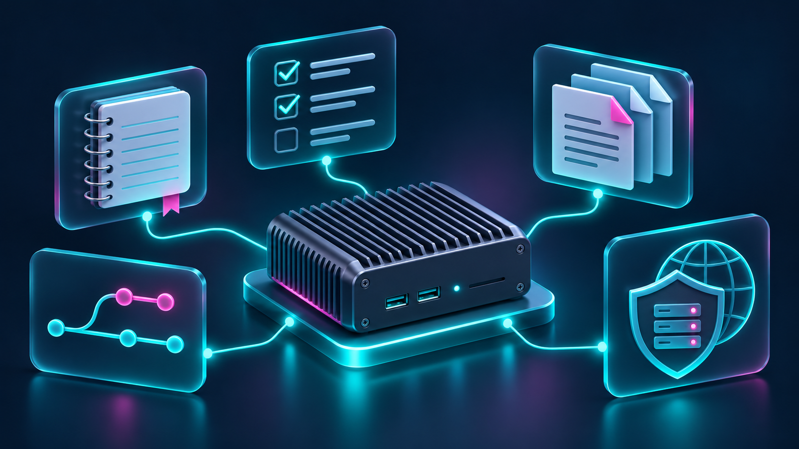

# v1.2 — A more useful everyday homelab

Published: 2026-11-03

Notes, tasks and PDF tools join the lab, alongside private Git hosting, per-device DNS filtering and verified MCP access. A KB-backed update on what is running and what still needs work.

The latest additions make the fanless Fujitsu FUTRO S940 useful beyond its original role: a place to keep notes, manage tasks, work with PDFs and host private Git repositories. This update draws on the private knowledge base, reviewed on 3 November 2026, with fresh read-only checks of the relevant running services.

## Notes, tasks and PDFs

Three everyday tools were added on 1 November. **Trilium Notes** provides a self-hosted home for notes. **Vikunja** adds task management, backed by PostgreSQL. **Stirling-PDF** brings PDF utilities onto the same machine.

During today's checks, all three application endpoints returned HTTP 200. Trilium and Stirling-PDF reported healthy container status; Vikunja was running and its PostgreSQL container was healthy. These checks confirm availability, rather than a full test of every application feature.

The KB now has a separate entry for each service, including its persistent data and maintenance commands. That makes the next restart, upgrade or recovery less dependent on remembering how the service was installed.

## Private Git hosting with Forgejo

Forgejo LTS was added on 27 October. It runs as a non-root container with a read-only root filesystem, dropped capabilities and resource limits. Registration is disabled, sign-in is required and new repositories default to private.

The installation record includes successful browser sign-in, authenticated HTTPS push and clone, anonymous-access refusal, and a test commit surviving a container restart. Forgejo was also healthy during today's inspection. Existing GitHub repositories have not been migrated: this is an additional private workspace.

## DNS filtering one device at a time

Pi-hole was introduced as a targeted pilot rather than a network-wide switch. Its profiles separate an unfiltered default from explicitly enrolled devices, with Standard and Xbox groups available for onboarding.

The KB records server-side policy tests and observed console queries. The owner reported that console sign-in, Store access, downloads, multiplayer and party chat worked after the DNS change. Those reports are useful functional evidence; they do not establish improved latency or throughput. Router-wide DNS and DHCP were left unchanged.

Dashboard links now lead directly to Pi-hole administration and device onboarding. The resolver remains LAN-only, while remote administration is protected by an owner-only identity check and Pi-hole's own login.

## MCP access with clearer boundaries

On 28 October, OAuth and personal bearer-token access were verified through separate client profiles. Each loaded the same 39-tool inventory in a fresh client process; unauthenticated initialization was rejected, and a read-only host-status request succeeded through bearer authentication.

The tunnel tooling also gained an important boundary: it detects when Cloudflare owns the active configuration and refuses local route edits against an inactive snapshot. Remote routing changes must use the authoritative control plane. This avoids a local configuration file giving a misleading picture of what is actually live.

## Recovery remains part of the work

The service entries describe what needs to be preserved: note data, task attachments and database contents, and PDF-tool configuration. These are recovery requirements, not evidence that a complete nightly or off-site backup system has been implemented. Independent backups and restore testing remain follow-up work.

The operational habit stays the same: inspect first, make a scoped change, verify its actual behavior and update the KB. Dated evidence matters, especially when a later entry supersedes an earlier pending check.

## A route back home

The blog's shared header now includes a visible Home link, including at phone widths, and the PitcherHomeLab brand returns to the landing page. Readers can move from a release post back to the hardware overview and roadmap without editing the URL.

Explore the [project home](https://lewis.support/), browse [all releases](https://lewis.support/releases), or try the [Lab simulator](https://lewis.support/lab). The simulator is illustrative; it is not a live status dashboard.

[Read on lewis.support](https://lewis.support/releases/v12-a-more-useful-everyday-homelab)
