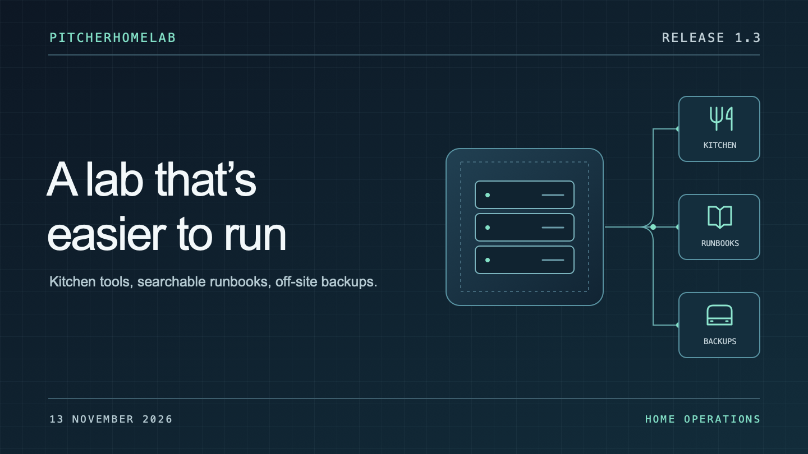

# v1.3 — A lab that’s easier to run

Release date: 2026-11-13

Recipe planning and pantry inventory join the lab, with searchable runbooks, tighter access controls and verified off-site backup snapshots.

Since v1.2, PitcherHomeLab has gained two kitchen tools and a working off-site backup job. This release also records how the private knowledge base was reorganized and what the latest checks can tell us about remote access.

## Recipes and pantry inventory

Mealie organizes recipes and meal plans. Grocy tracks pantry inventory and shopping lists. On 13 November, both applications answered locally and their remote routes redirected unauthenticated requests to an identity check. The notes, tasks and PDF tools now use the same kind of access gate.

A workflow that would send Mealie shopping-list items to Grocy was imported into n8n. It remains inactive; application credentials and an end-to-end sync test are still pending.

## Runbooks you can find

The private knowledge base now starts with topic categories and full-text search. Access, applications, automation and recovery each have their own place, and the change log records what was tested and what remains open. On narrow screens, long text wraps and wide tables scroll within the article. Existing links still lead to their sections.

## Remote access with clear boundaries

The remote MCP uses authenticated Streamable HTTP and checks permissions for each tool. The original rollout verified passkey sign-in, OAuth consent and automatic token renewal. In the 13 November checks, the service rejected a request without credentials and a read-only host status call succeeded through the authenticated connector. The legacy transport stayed closed.

## Encrypted backups are running

A weekly Restic job sends encrypted snapshots of service data and configuration to off-site object storage. On 13 November, the job completed successfully and its log recorded consistent SQLite copies of both kitchen apps. Vaultwarden, the self-hosted password manager added earlier in November, also had a database snapshot recorded after deployment.

A completed backup shows that data was captured. A full restore drill is still pending.

## Two reliability fixes

Container DNS resolution was restored after a resolver change left containers unable to resolve external names. A lookup from the media container worked during the 13 November check. Docker’s address pools were also expanded after the lab ran out of default network allocations. The change log records a successful allocation after the restart.

Read the [other releases](https://lewis.support/releases) or explore the [Lab simulator](https://lewis.support/lab), which uses simulated data.

[Read on lewis.support](https://lewis.support/releases/v13-a-lab-thats-easier-to-run)
