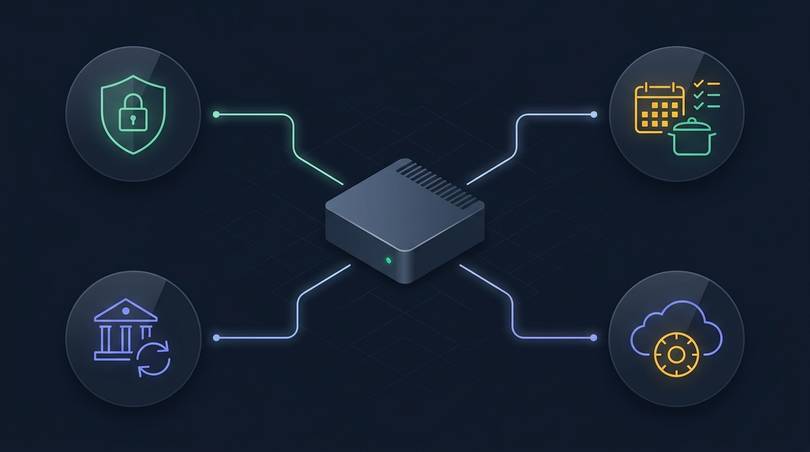

# v1.4 — Local-only HTTPS, Open Banking sync, and a connected household stack

Release date: 2026-11-25

Local-only wildcard HTTPS without exposing internal ports, native EU Open Banking sync in Actual Budget, a connected Grocy–Mealie–OpenFamily household workflow, and tightened R2 backups with an AI agent rulebook.

Since v1.3, PitcherHomeLab has moved from standalone self-hosted apps to a genuinely connected household and networking stack. This release covers four major technical upgrades: a dedicated local-only HTTPS wildcard reverse proxy, native EU Open Banking integration in Actual Budget, an automated shopping-to-meal-plan pipeline across Grocy, Mealie, and OpenFamily, and tightened backup and agent governance rules.

## Local-only HTTPS reverse proxy (no more port numbers)

Typing raw LAN IP addresses and ports gets old fast, but not every internal tool belongs on the public internet. To keep local-only services strictly private while still getting clean domain names and valid TLS padlocks, the lab now runs a split local reverse proxy under a dedicated internal wildcard subdomain.

- **Local wildcard DNS:** Pi-hole resolves the internal wildcard zone directly to the host on the LAN, with zero public DNS records and zero external tunnel routes.
- **Private wildcard TLS:** A Let’s Encrypt ECDSA wildcard certificate is issued and renewed automatically via Cloudflare DNS-01 validation—no public port exposure required.
- **LAN/Tailscale-only Nginx map:** A single Nginx `map $host` configuration routes over 40 services behind a strict IP allowlist (LAN and Tailscale ranges only; all other sources denied), while keeping raw IP:port access working as a fallback.
- **3-mode dashboard link rewriting:** Homepage’s dynamic link rewriter now distinguishes between internal wildcard visits, raw LAN IP visits, and external proxied visits so every click stays on the matching transport path.

## Native EU Open Banking in Actual Budget

Actual Budget (v26.11.0) now syncs directly with European PSD2 Open Banking APIs via its built-in Enable Banking integration—no third-party bridge containers required.

- **Reverse proxy long-poll hardening:** Actual’s bank authorization flow uses a 300-second long-poll endpoint (`/enablebanking/poll-auth`) while waiting for mobile SCA approval. Nginx Proxy Manager’s proxy read/send timeouts for the budget host were raised from the 90-second default to 360 seconds and persisted in both the NPM database and generated config.
- **Automated rule-based categorization:** Using the official `@actual-app/api` sync client in a disposable container (so CRDT sync stays clean and no raw SQLite files are touched), transactions are organized into a structured category hierarchy backed by 40 automatic payee rules for future syncs.

## Connected household stack: Grocy, Mealie, and OpenFamily

The kitchen and family apps introduced in v1.3 are now wired together into a cohesive monthly workflow instead of isolated silos:

- **Grocy master-data sanitization:** Added proper storage locations (including freezer-flagged storage for freeze/thaw workflows), local store directories with branch addresses, aisle-ordered product groups, metric/German quantity units with automatic conversions, and native price history so shopping lists calculate real unit and list totals without cramming prices into text notes.
- **Store-sorted lists & calendar tasks:** Shopping lists are split cleanly by store and paired with dated shopping tasks that appear on both Grocy’s calendar and the shared family calendar.
- **Mealie & OpenFamily sync:** Structured multi-serving recipes and a full 31-day meal schedule (breakfast, lunch, and dinner) were pushed via API into both Mealie and OpenFamily, with direct recipe links in the family planner so everyone in the household can see what is planned each day.

## Backup gap closure & AI agent operating rulebook

An audit of running containers and named volumes against the weekly Restic-to-Cloudflare-R2 pipeline turned up three gaps—all closed at zero extra cost inside the existing R2 bucket:

- Added an online `mariadb-dump --single-transaction --quick` step for the MariaDB appointment database.
- Added the Open WebUI named Docker volume to both `BACKUP_PATHS` and `DB_SCAN_DIRS` so its SQLite database is staged atomically alongside the other apps.
- Added tunnel credentials, host helper scripts, and the new server-wide operating policy files to the deduplicated backup paths.

Finally, because multiple AI coding agents and SSH sessions touch the server, a clear operating rulebook (`AGENTS.md` / `CLAUDE.md`) and a pre-auth SSH banner now enforce standard homelab hygiene on every connection: log every change in the private knowledge base, resolve Docker port conflicts cleanly without stealing ports, preserve dual local/proxied dashboard routing, enforce OAuth/SSO by default (with explicit pre-approval before any exception), and verify R2 backup coverage.

Read the [other releases](https://lewis.support/releases) or explore the [Lab simulator](https://lewis.support/lab), which uses simulated data.

[Read on lewis.support](https://lewis.support/releases/v14-local-https-open-banking-and-household-automation)
